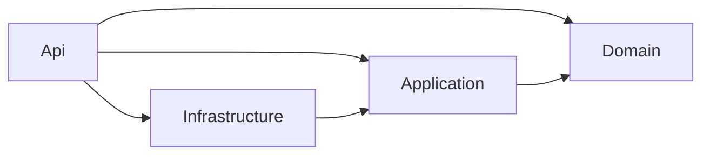

# Phase 1: application architecture

FleetOps remains a single deployable application with four assemblies. The existing asset CRUD endpoints are preserved. SQL Server, authentication, and work-order features are not implemented yet.

## Dependencies and responsibilities



- **API** binds and validates HTTP requests, maps application DTOs to response contracts, and translates exceptions to ProblemDetails. Program.cs is the composition root: the place where implementations are connected to interfaces.
- **Application** owns asset use cases and the persistence interface. AssetService constructs valid domain assets and delegates storage operations. It stays deliberately small while there are no multi-entity workflows.
- **Domain** owns asset validation and status transitions. It has no ASP.NET Core or persistence dependencies.
- **Infrastructure** implements persistence. Its in-memory repository is temporary and will be replaced by EF Core in Phase 2.

The API references Infrastructure to register the implementation. Controllers depend only on the application interface. Domain is also referenced by the API for the status enum and domain-error mapping.

## Decisions

1. **Scoped application service, singleton in-memory repository.** Each request receives an AssetService while all requests share one repository. A scoped in-memory repository would lose data at the end of every request. With EF Core, the repository and DbContext will be scoped.
2. **A narrow repository instead of a generic framework.** IAssetRepository exists to move storage out of controllers and application services. It exposes only current asset operations. Read projections are immutable application records. UpdateDetails calls the domain method within the repository lock; storage coordinates mutation, while the domain defines its rules.
3. **One lock around each repository operation.** This protects dictionary access and read/update/delete operations in one process. Reads materialize immutable snapshots under the lock. It does not provide database concurrency control or protect multiple application instances.
4. **Separate HTTP response contracts.** AssetResponse prevents domain entities from becoming public response contracts. The wire shape and numeric enum serialization remain compatible with the original API.
5. **Explicit domain conflicts.** DomainRuleException identifies business-rule failures without treating every InvalidOperationException as a client error. Central handling maps domain conflicts to 409, argument errors to 400, and unexpected exceptions to a generic 500 with server-side logging. ApiController handles request-model validation. Status-code middleware supplies ProblemDetails for otherwise empty HTTP error responses.
6. **Preserve existing retirement behavior.** Operational and Maintenance assets can retire. Retired assets cannot return to service, enter maintenance, change details, or retire again.
7. **Synchronous operations for synchronous storage.** There is no fake asynchronous wrapper around dictionary access. Async methods and cancellation support arrive with database I/O in Phase 2.
8. **Development-only seeds.** Development starts with two sample assets. Other environments start empty. No credentials are added.

## Local verification

```powershell
dotnet build FleetOps.slnx -m:1 -p:UseSharedCompilation=false
dotnet test FleetOps.slnx -m:1 -p:UseSharedCompilation=false
dotnet run --project src/FleetOps.Api --launch-profile http
```

If Windows Application Control blocks the generated executable, after building run:

```powershell
dotnet src/FleetOps.Api/bin/Debug/net10.0/FleetOps.Api.dll --urls http://localhost:5252 --environment Development
```

The shared-compilation option avoids a compiler-server named-pipe access failure observed in this workspace. No SDK or host-policy settings were changed.

Verified results: the final solution build passed with zero warnings and zero errors. All 17 domain/application tests passed. These cover constructor validation, state transitions, terminal retirement, atomic validation failures, shared storage across services, CRUD, snapshots, missing resources, explicit seeding, and concurrent creates.

Three additional error-handler test cases compile but could not execute: Windows Application Control blocked FleetOps.Api.Tests.dll from loading (0x800711C7). Their results remain unverified. These tests target ASP.NET Core ProblemDetails serialization without hosting the HTTP pipeline; they are not WebApplicationFactory integration tests. No machine security settings were changed.

Manual HTTP checks verified development seeds, asset creation and Location, reads across requests, update persistence, deletion, validation errors, missing resources, and OpenAPI/Scalar availability.

## Remaining limitations

- In-memory data disappears on restart and is not shared across instances.
- Concurrent edits use last-write-wins behavior; no version token exists.
- Serial uniqueness, length limits, timestamps, indexes, pagination, filtering, sorting, transactions, and SQL Server constraints remain Phase 2 work.
- No authentication, roles, assignment policies, or production transport configuration exists yet.
- Asset lifecycle methods are domain behavior; lifecycle HTTP endpoints remain Phase 3.
- Comprehensive hosted integration tests and SQL Server Testcontainers remain later work.
- The test runner reports a VSTEST_ARTIFACTS_DIRECTORY fallback warning. Tests pass; test-tooling modernization is deferred.
- No performance or coverage claims have been measured.

## Learning checkpoints

Trace POST /api/assets through AssetsController, IAssetService, AssetService, Asset, and IAssetRepository to InMemoryAssetRepository. In Node.js terms, constructor injection replaces manually importing a shared mutable store, while the composition root wires dependencies.

An interface is a contract, not an implementation or a runtime instance. DI creates the objects and supplies them through constructors. A record DTO is a value-shaped snapshot; it does not expose the mutable Asset object.

Try recreating GetAssetById without looking. Decide which layer should choose HTTP 404 and which layer should query storage.

Interview questions:

1. Why is AssetService scoped while this repository is singleton, and how should their lifetimes change with DbContext?
2. Why do request validation, domain validation, and eventual database constraints all exist?

Suggested commit: Refactor asset CRUD into application and infrastructure layers.
