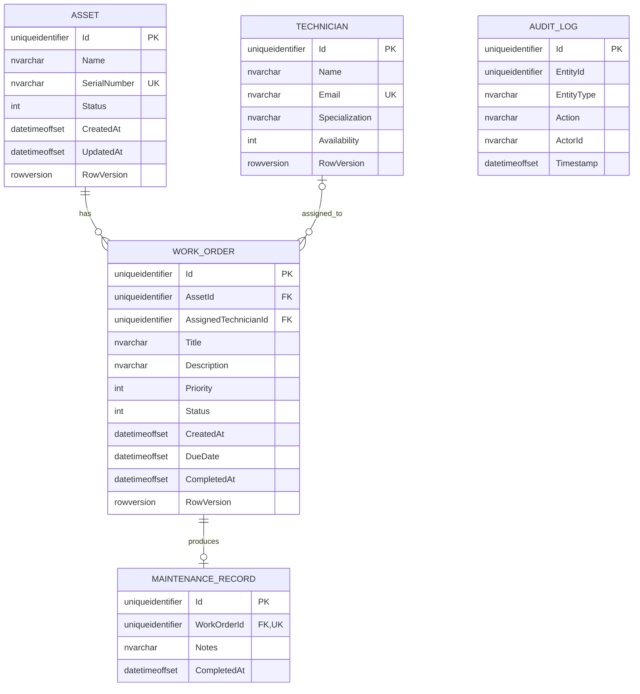

# Phase 2: database and data access

This is the Phase 2 checkpoint. See [Phase 3](phase-3-api.md) for the current maintenance endpoints and HTTP test results.

Phase 2 replaces the temporary asset collection with SQL Server persistence. Phase 1 notes describe the previous implementation.

## Implemented

- EF Core 10.0.15 SQL Server provider, scoped DbContext, async asset repository/service, and CancellationToken propagation.
- Asset, Technician, WorkOrder, MaintenanceRecord, and AuditLog mappings with an initial migration and model snapshot.
- Required columns, maximum lengths, case-insensitive unique serial numbers and emails, foreign keys, restrictive deletion, check constraints, and query indexes.
- Asset creation/update timestamps and SQL Server rowversion concurrency tokens on assets, technicians, and work orders.
- Atomic audit persistence alongside business writes, with system as the temporary actor.
- Paginated asset queries with search/status filters, safe sorting, projections, and no tracking.
- Development-only database initialization and repeatable sample seeding.
- Local SQL Server Compose service and isolated SQL Server Testcontainers tests.

## Relationships



AuditLog has a logical entity reference, intentionally not a database FK. It survives asset deletion. Work orders restrict deleting referenced assets/technicians; maintenance records restrict deleting their work orders.

## Run locally

Prerequisites: .NET 10 SDK and Docker Desktop in Linux-container mode.

1. Copy .env.example to .env. Choose a strong local-only password and put the same value in MSSQL_SA_PASSWORD and the connection string. The implementation session created an ignored .env with a random local password; if it is still present, reuse it.
2. Start SQL Server, load settings, restore tooling, build, then initialize:

```powershell
docker compose up -d --wait sqlserver
. ./scripts/Use-LocalDatabase.ps1
dotnet tool restore
dotnet build FleetOps.slnx -m:1 -p:UseSharedCompilation=false
dotnet run --project src/FleetOps.Api --no-build -- --environment Development --initialize-database
dotnet run --project src/FleetOps.Api --no-build --launch-profile http
```

Initialization applies migrations, seeds one asset, one technician, and one assigned work order, then exits. It is rejected outside Development. Existing assets from Phase 1 were in memory and cannot be recovered from a restarted process.

SA credentials and TrustServerCertificate are local development settings. Deployment should use a separate least-privilege identity, validated certificates, and a migration identity. Changing the .env password does not change the password inside an existing SQL volume.

Stop infrastructure with docker compose stop. The named volume preserves development records.

## Migrations

For a read-only status check that refreshes local process settings and rejects unknown status:

```powershell
./scripts/Get-MigrationStatus.ps1
```

See [the design-time connectivity diagnosis](sql-server-connection-diagnosis.md) if a previously opened shell still uses localhost.

```powershell
. ./scripts/Use-LocalDatabase.ps1
dotnet ef migrations list --project src/FleetOps.Infrastructure
dotnet ef database update --project src/FleetOps.Infrastructure
dotnet ef migrations add DescribeYourChange --project src/FleetOps.Infrastructure --output-dir Persistence/Migrations
dotnet ef migrations script --idempotent --project src/FleetOps.Infrastructure --output migration.sql
```

The design-time factory reads ConnectionStrings__FleetOps and reports a configuration error if it is absent. Neither EF tooling nor normal application startup automatically loads .env; dot-source scripts/Use-LocalDatabase.ps1 first. The Docker service publishes IPv4 loopback, so use Server=tcp:127.0.0.1,14333 from Windows.

## Asset API contract changes

GET /api/assets now returns:

```json
{
  "items": [],
  "page": 1,
  "pageSize": 20,
  "totalCount": 0
}
```

Example query:

```http
GET /api/assets?page=1&pageSize=20&search=pump&status=Operational&sortBy=name&descending=false
```

Page size is 1–100. Sort fields are name, serialNumber, createdAt, and status, with ascending Id used as a stable tie-breaker. Status responses remain numeric for compatibility. Search matches a name or serial-number substring; normal SQL parameters prevent injection.

GET by id and POST return ETag plus a base64 rowVersion field. To update:

```http
PUT /api/assets/{id}
If-Match: "BASE64_FROM_LATEST_GET"
Content-Type: application/json

{"name":"Updated Pump","serialNumber":"HP-003"}
```

DELETE also requires If-Match. After a successful PUT, GET again for the latest ETag. Missing If-Match returns 428, malformed returns 400, and stale returns 412. Duplicate serial numbers or restricted deletions return 409. Other errors use ProblemDetails.

## Tests and verification

```powershell
dotnet test FleetOps.slnx -m:1 -p:UseSharedCompilation=false
```

The infrastructure test project needs access to a Linux Docker engine. It starts one SQL Server container and creates a separate migrated database for each test, then drops only that test's database. Fixtures clean up their containers.

On this machine Docker access required elevated execution. Windows Application Control also blocked loading several locally built assemblies. A portable Linux verification image is included:

```powershell
./scripts/Test-InDocker.ps1
```

This builds and runs tests with the Docker socket available to Testcontainers. It is a local verification image, not the production deployment image. No host security settings are changed.

For a temporary local API using that image on Docker Desktop, after starting SQL Server and building the verification image:

```powershell
. ./scripts/Use-LocalDatabase.ps1
$env:ConnectionStrings__FleetOps = $env:ConnectionStrings__FleetOps.Replace('tcp:127.0.0.1,14333', 'tcp:sqlserver,1433')
docker run --rm --network fleetops_default -e ConnectionStrings__FleetOps fleetops-verify:phase2 dotnet src/FleetOps.Api/bin/Debug/net10.0/FleetOps.Api.dll --environment Development --initialize-database
docker run --rm --network fleetops_default -p 127.0.0.1:5252:8080 -e ConnectionStrings__FleetOps fleetops-verify:phase2 dotnet src/FleetOps.Api/bin/Debug/net10.0/FleetOps.Api.dll --environment Development --urls http://0.0.0.0:8080
```

In another PowerShell window, run `./scripts/Test-Assets.ps1` against that local API. The script creates isolated asset fixtures and deletes them in a finally block; their audit history remains.

Verified on November 19, 2026:

- Windows and Linux solution builds passed with zero warnings and zero errors.
- The complete Linux test suite passed: 6 API error-handler cases, 10 application-query cases, 15 domain cases, and 11 real SQL Server persistence cases (42 total).
- All 19 HTTP smoke checks passed against the SQL-backed API, covering CRUD, ETags, stale writes, query validation, pagination/filtering/sorting, duplicate serial conflicts, and ProblemDetails.
- The initial migration applied to local SQL Server, development seeding succeeded, and EF generated an idempotent SQL migration script.
- Asset identity persisted across an API container restart. The temporary API verification container was then removed; the local SQL Server service and its volume remain available.
- Windows-hosted execution remains limited by the machine's Application Control policy; it is not reported as a successful full host test run.

## Decisions and limitations

See decisions/0002-sqlserver-persistence.md for transaction, indexing, lifetime, collation, and concurrency decisions.

Other entity endpoints, ownership checks, and authentication remain future phases. WorkOrder.Complete returns a MaintenanceRecord; the caller must add that record and save the order together. Domain methods enforce workflows while database checks enforce row consistency. Cross-table rules are not all expressible as check constraints.

Audit logging only covers changes tracked by this DbContext and uses a placeholder actor. No security audit, performance benchmark, coverage percentage, or deployment claim is implied.

Offset pagination can shift between requests during concurrent writes. Count and page queries are not a consistent snapshot. Consider keyset pagination if measurements justify it.

## What to understand

DbContext is a request-scoped change tracker and Unit of Work. LINQ before ToListAsync builds an expression that EF translates to SQL; it does not load the full table and then filter in C#. AsNoTracking avoids tracking overhead for read-only projections.

A rowversion is an opaque database-generated version, not a date or a counter to increment yourself. If two technicians load the same open order, both may pass domain checks in memory. The database permits one write with that original version and rejects the other.

Interview questions:

1. Why must serial uniqueness be enforced by the database even if the application checks first?
2. What does EF send to SQL Server when two requests save the same rowversion, and how should the API tell the losing client?

Exercise: trace the asset list query and explain which operations execute in SQL. Then sketch how completing an order and creating its maintenance record can be committed atomically.

Suggested commits:
- Add maintenance domain entities and persistence constraints.
- Replace in-memory assets with async EF Core SQL Server persistence.
- Add conditional asset writes and paginated queries.
- Add SQL Server migration, development initialization, and database tests.

References: [EF Core SQL Server value generation](https://learn.microsoft.com/en-us/ef/core/providers/sql-server/value-generation), [applying migrations](https://learn.microsoft.com/en-us/ef/core/managing-schemas/migrations/applying), and [SQL Server Testcontainers](https://dotnet.testcontainers.org/modules/mssql/).
