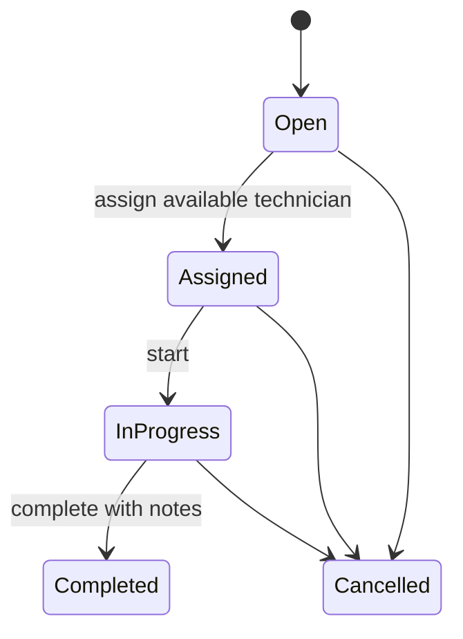

# Phase 3: REST API and maintenance workflows

Phase 3 added asset lifecycle actions, technician management, work-order workflows, and a dashboard summary. This is a historical checkpoint: [Phase 4](phase-4-security.md) now requires authentication and role/assignment authorization. The earlier unauthenticated container instructions below describe the Phase 3 checkpoint.

## Routes

| Method | Route | Success |
| --- | --- | --- |
| GET | /api/assets | 200 paginated list |
| GET | /api/assets/{id} | 200 asset and ETag |
| POST | /api/assets | 201 representation, Location, ETag |
| PUT | /api/assets/{id} | 204 |
| DELETE | /api/assets/{id} | 204; existing endpoint retained, foreign-key deletes restricted |
| POST | /api/assets/{id}/maintenance | 204 |
| POST | /api/assets/{id}/return-to-service | 204 |
| POST | /api/assets/{id}/retire | 204 |
| GET | /api/technicians | 200 paginated list |
| GET | /api/technicians/{id} | 200 representation and ETag |
| POST | /api/technicians | 201 representation, Location, ETag |
| PUT | /api/technicians/{id} | 200 updated representation and ETag |
| GET | /api/work-orders | 200 paginated list |
| GET | /api/work-orders/{id} | 200 representation and ETag |
| POST | /api/work-orders | 201 representation, Location, ETag |
| PUT | /api/work-orders/{id} | 200 updated representation and ETag |
| POST | /api/work-orders/{id}/assign | 200 updated representation and ETag |
| POST | /api/work-orders/{id}/start | 200 updated representation and ETag |
| POST | /api/work-orders/{id}/complete | 200 representation including maintenance record, ETag |
| POST | /api/work-orders/{id}/cancel | 200 updated representation and ETag |
| GET | /api/dashboard/summary | 200 aggregate counts |

Every update, delete, and lifecycle action requires a strong If-Match header copied from the resource's latest ETag. Create requests do not require one. Missing: 428; malformed: 400; stale: 412. Asset 204 responses require a subsequent GET for the current ETag.

Missing resources/references return 404; invalid transitions, unavailable technicians, retired-asset operations, and uniqueness conflicts return 409. Validation returns 400. Errors use ProblemDetails; model errors include field validation details.

OpenAPI and Scalar remain available in Development. OpenAPI describes request/response contracts, query filters, error responses, and required conditional-write headers.

## Workflow



- Assignment requires an open order and an available technician. Existing assignments cannot be overwritten by another assignment request.
- Completed/cancelled orders cannot be edited or transitioned.
- Editable order fields are title, description, priority, and due date; its asset identity is immutable.
- New work orders, assignments, and starts reject retired assets.
- Completion validates notes before mutating state, creates a MaintenanceRecord, then saves the order, record, and audit entries in one EF transaction.
- Asset maintenance and work-order status are independent workflows; completing an order does not automatically return the asset to service.

## Queries and contracts

All collection responses use items, page, pageSize, and totalCount. Page size is 1-100. Every sort uses Id as a deterministic tie-breaker.

| Resource | Search fields | Filters | Sort fields |
| --- | --- | --- | --- |
| Assets | name, serialNumber | status | name, serialNumber, createdAt, status |
| Technicians | name, email, specialization | availability | name, email, specialization, availability |
| Work orders | title, description | status, priority, assetId, technicianId | title, createdAt, dueDate, priority, status |

Sort fields are case-sensitive allowlisted strings; descending=true reverses the selected field. Enum query values accept names or defined numbers. JSON enum properties remain numeric. TechnicianAvailability: Available=0, Unavailable=1. WorkOrderPriority: Low=0, Medium=1, High=2, Critical=3. WorkOrderStatus: Open=0, Assigned=1, InProgress=2, Completed=3, Cancelled=4.

The API returns HTTP response contracts, never tracked EF entities. Work-order details and list items include an optional maintenanceRecord with id, notes, and completedAt.

Dashboard counts cover asset statuses, total/available technicians, each order status, and overdue nonterminal orders. Overdue means dueDate is earlier than the request-time UTC timestamp. Aggregate queries are independent reads, not a consistent multi-table snapshot.

## Example requests

Create a technician:

```http
POST /api/technicians
Content-Type: application/json

{"name":"Alex Morgan","email":"alex@example.test","specialization":"Hydraulics","availability":0}
```

Create a work order using an existing asset id:

```http
POST /api/work-orders
Content-Type: application/json

{"assetId":"REPLACE_WITH_ASSET_GUID","title":"Inspect seals","description":"Inspect hydraulic seals for leaks.","priority":2}
```

Copy the returned ETag into the next request:

```http
POST /api/work-orders/REPLACE_WITH_ORDER_GUID/assign
Content-Type: application/json
If-Match: "REPLACE_WITH_ETAG_VALUE"

{"technicianId":"REPLACE_WITH_TECHNICIAN_GUID"}
```

Start using the ETag from assignment, then complete using the ETag from start:

```http
POST /api/work-orders/REPLACE_WITH_ORDER_GUID/complete
Content-Type: application/json
If-Match: "REPLACE_WITH_LATEST_ETAG_VALUE"

{"notes":"Replaced the damaged seal and verified normal operation."}
```

## Architecture and files

- Domain/Entities/WorkOrder.cs adds atomic detail validation and terminal-state protection.
- Application/Services/MaintenanceService.cs coordinates reference checks, domain transitions, maintenance-record creation, and a single save.
- Application/Interfaces/IMaintenanceStore.cs is one workflow persistence boundary shared by the scoped service. It avoids generic repositories and keeps EF references out of Application.
- Infrastructure/Persistence/EfMaintenanceStore.cs implements LINQ queries, projections, concurrency checks, and dashboard aggregation.
- Infrastructure/Persistence/PersistenceWrites.cs translates SQL uniqueness/constraint failures and EF concurrency exceptions without leaking database messages.
- AssetService and EfAssetRepository add existing domain lifecycle operations.
- API/Controllers adds technicians, work orders, dashboard, and asset actions; API/Contracts adds distinct request/response DTOs.
- API/Http/EntityTags.cs centralizes strong ETag formatting/parsing.
- Program.cs registers scoped services, documents conditional headers, and reads connection configuration after host overrides are available while still validating it at startup.
- API tests use WebApplicationFactory with isolated SQL Server databases and real HTTP requests. The production factory and local connection configuration remain unchanged.

No database schema change or new migration is required. The existing migration snapshot is checked by the persistence tests.

## Run and test

```powershell
. ./scripts/Use-LocalDatabase.ps1
dotnet build FleetOps.slnx -m:1 -p:UseSharedCompilation=false
dotnet run --project src/FleetOps.Api --no-build --launch-profile http
```

Review /scalar/v1 or /openapi/v1.json in Development.

Runnable request examples are in src/FleetOps.Api/FleetOps.Maintenance.http. Replace IDs and refresh the ETag value between successful mutations.

```powershell
dotnet test FleetOps.slnx -m:1 -p:UseSharedCompilation=false
./scripts/Test-InDocker.ps1
```

The Docker script builds fleetops-verify:phase3 and runs tests with access to the Linux Docker engine. API tests and persistence tests use ephemeral SQL Server containers and a separate database per test. They never initialize or migrate the local development FleetOps database.

Windows Application Control blocked the generated API executable in this workspace, so the verified Linux image was also used to restore the local development API at http://localhost:5252. The running container is fleetops-phase3-api. OpenAPI, Scalar, and a read-only dashboard query against the existing development SQL Server were verified. No host policy was changed and no development migration was applied.

To stop that local API: `docker stop fleetops-phase3-api`. To start it again after building the verification image:

```powershell
. ./scripts/Use-LocalDatabase.ps1
$env:ConnectionStrings__FleetOps = $env:ConnectionStrings__FleetOps.Replace('tcp:127.0.0.1,14333', 'tcp:sqlserver,1433')
docker run -d --rm --name fleetops-phase3-api --network fleetops_default -p 127.0.0.1:5252:8080 -e ConnectionStrings__FleetOps -e Logging__LogLevel__Default=Warning fleetops-verify:phase3 dotnet src/FleetOps.Api/bin/Debug/net10.0/FleetOps.Api.dll --environment Development --urls http://0.0.0.0:8080
```

This is a local development fallback using the SDK verification image. Production container packaging remains Phase 8.

Verified on November 19, 2026:

- Windows and Linux solution builds passed with zero warnings and zero errors.
- The complete Linux suite passed: 14 API cases (8 hosted SQL-backed workflows plus 6 error-handler cases), 10 application cases, 16 domain cases, and 11 SQL persistence cases: 51 total, zero failures or skips.
- Hosted checks cover lifecycle persistence, completion records and audits, terminal-state rejection, validation/malformed JSON, missing references, technician edits/availability, duplicate emails, pagination/filtering/sorting, dashboard counts, ETags, concurrent HTTP assignment, and OpenAPI route/header metadata.
- The existing model/migration consistency check passed; no new migration was generated or applied to the development database.

## Limits

- Endpoints remain unauthenticated until Phase 4; roles, ownership, and assignment authorization are not implemented.
- Technician availability is an explicit setting, not an automatically calculated capacity or schedule.
- Availability and retired-asset checks validate the state read by the request; concurrent changes across different aggregate rows are not serialized by a global workflow lock.
- Rowversion protects concurrent writes to the same asset, technician, or order. There is no automatic retry of a rejected edit.
- No reassign/reopen endpoint, asset/order automatic state synchronization, or technician delete endpoint is introduced.
- Count/page and dashboard queries can reflect slightly different instants during concurrent writes.
- No caching or performance claims have been added.
- Application audit actors remain system until authenticated identity is implemented.

## Learning checkpoint

Trace POST /api/work-orders/{id}/complete through the controller, MaintenanceService, WorkOrder.Complete, and EfMaintenanceStore.SaveAsync. Notice that the domain returns a record without saving it. The application adds it to the shared unit of work; EF persists it and the order in the same transaction.

In Node.js terms, this resembles a request-scoped service coordinating mutations through one ORM transaction, with explicit request/response schemas and HTTP error translation.

Interview questions:

1. Why must completion and its maintenance record use one SaveChanges transaction?
2. If two HTTP assignment requests send the same ETag, which layers reject the loser and which HTTP status should it receive?

Challenge: recreate the cancellation endpoint without looking, including the current ETag requirement and the distinction between a missing order and an invalid state transition.

Suggested commit: Add maintenance REST workflows, conditional writes, dashboard queries, and hosted SQL Server integration tests.

References: [ASP.NET Core hosted integration tests](https://learn.microsoft.com/en-us/aspnet/core/test/integration-tests?view=aspnetcore-10.0).
